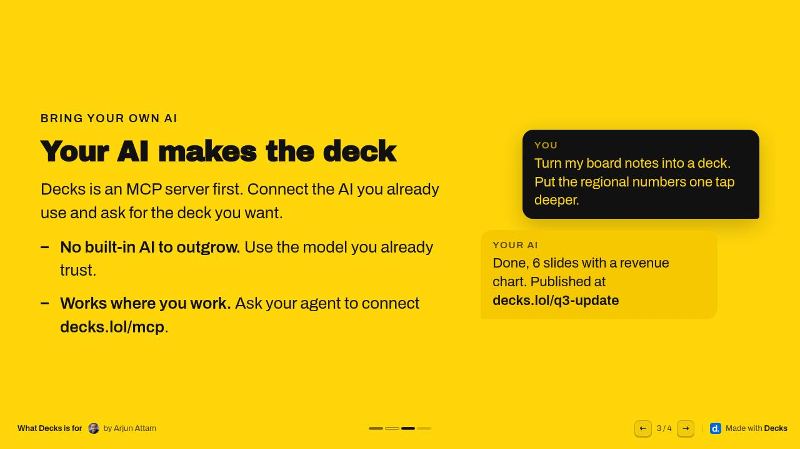
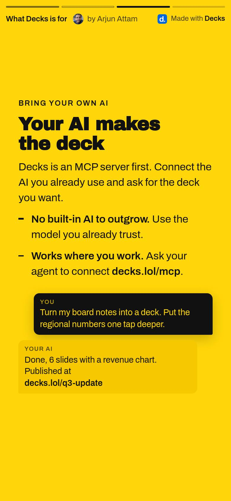

Here's how this blog post will reach you: when I finish typing[^1] it out, I'll push it to GitHub, which triggers a Vercel deployment. When you open it in your browser, Vercel will serve it to you. Broadly speaking, there are 3 "computers" at work: my laptop ("dev"), the CI machine that builds the code into the final servable product, and then the machine that is serving it to you ("prod").

[^1]: Yes, this post is organic human text, typed one character at a time.

There's merit to this split: prod needs scale and stability, dev can be messy and broken. But for my blog, and a lot of simple software like it, this supply chain is just unwanted ceremony. When [exe.dev](https://blog.exe.dev/big-serverless-has-taken-us-for-fools) says "big serverless has taken us for fools", I nod my head. It's time to question this supply chain.

It's time because code is now how agents create valuable artifacts: an app, a presentation on [Decks](https://decks.lol/), "hand-drawn art, written as code" (with [anidoodle](https://github.com/alexgreensh/anidoodle)), or even a proof of the Riemann Hypothesis.

## Everything is code

When I was [building Decks](/posts/2026/intro-decks-lol/), I knew every deck had to be code: agents are great at writing it, and code can express anything.

Presentation tools today give you pre-built layouts and five ways to animate. That's because 1. users need affordances, and 2. a finite set of options is what they could ship. Agents let us question both: users can say what they want in words, so they need fewer affordances, and agents can write code, so the options don't have to be finite.

But code needs a supply chain with 3 computers to run dev, build, and prod. Our current solution (git repo with CI/CD) is too heavy when everything is code, and I think we'll see a lot more experimentation in the code supply chain.

For Decks, dev is prod: one "machine" (loosely speaking) acts as the whole supply chain, rebuilt on new primitives for storage (SQLite instead of git) and build (V8 isolates instead of VMs).

Also, if this reads as a love letter to Cloudflare, it is.

## Working backwards

<figure class="diagram wide">
<pre class="mermaid">
flowchart LR
  A[Agent writes Text, TSX, CSS] --> B[Black box]
  B --> C[Humans see rendered slides]
  classDef blackbox fill:#000,stroke:#5c6266,stroke-dasharray:4 4,color:#969a9c
  class B blackbox
</pre>
</figure>

My requirements while building Decks were:

- **Input is code**: Unrestricted, expressive code that lets the agent go crazy
- **Output in kilobytes**: Anyone anywhere, even on bad mobile data, should be able to view the final output
- **Fast iteration loop**: Agents should be able to edit a slide and see what it would look like, on desktop or mobile

[MDX with TSX](https://mdxjs.com/) felt like a good fit: old enough to be in training data, flexible and powerful, and the build/output stuff is mature enough to rely on.

Since it's code, I could map this to the standard code supply chain: agents push files to a git repo, wait for CI to build them, and then they get served like this blog. Git and CI are genuinely useful:

- **Git (versioning)** lets agents edit freely without breaking what viewers see
- **CI (build)** separates input from output: agents write expressive React, and viewers still get a few kilobytes of static HTML

What they don't give you is a fast iteration loop: CI takes minutes, at least. Turns out we can get the best of everything, with Cloudflare [Durable Objects](https://developers.cloudflare.com/durable-objects/), [Dynamic Workers](https://developers.cloudflare.com/dynamic-workers/), and [Browser Run](https://developers.cloudflare.com/browser-run/).

<figure class="diagram wide">
<pre class="mermaid">
flowchart TB
  A[Agent writes Text, TSX, CSS] -->|write| W
  subgraph DO [Durable Object per deck]
    W[Save draft] --> B[Build in isolate]
    L[Decks component library] -->|pinned version| B
    S[ ] ~~~ L
    W -.-> V[(Versions)]
    B -->|publish| P[HTML in R2]
  end
  B -.->|build result| A
  P --> C[Humans see rendered slides]
  classDef blackbox fill:#000,stroke:#5c6266,stroke-dasharray:4 4,color:#969a9c
  class DO blackbox
  classDef spacer fill:none,stroke:none
  class S spacer
</pre>
</figure>

## Swap git with SQLite for versioning

From the outside, Decks is an MCP server. Sitting behind this entrypoint, each deck is a Durable Object, backed by SQLite.

The database stores every version of the files that make up the deck, like a simpler git repo. Every edit creates a new version (like a commit in git), and "draft" and "published" are mere pointers to two versions. There is no staging environment and no deploy step: the draft your agent is editing lives right next to the version your readers see. Dev is prod.

## Instant builds on every edit

Each deck combines the input files (text + code) with the shared [component library](https://decks.lol/docs/components) that gets built into lightweight static HTML/JS/CSS.

Typical CI would run asynchronously on every code push. Instead, every time your agent uses [`write_files`](https://decks.lol/docs/mcp/tools#write_files), Decks runs the build synchronously, and the agent gets a response that looks something like this.

```json
{
  "version": 14,
  "build": "failed",
  "problems": "slides/pricing.mdx:12:5 Expected a closing tag for <Callout>"
}
```

This "instant CI" runs in a Dynamic Worker, which acts as a sandboxed isolate. Without any build optimizations (like caching), p90 build time is about 650ms right now (median is around 300ms), which makes CI work well within the request-response cycle.

## Closing the agent's iteration loop

Build errors are useful to catch mistakes, but agents need to see the final thing to iterate towards greatness. For that, Decks exposes a [`preview_deck`](https://decks.lol/docs/mcp/tools#preview_deck) tool that combines instant builds with browser rendering to return screenshots—in both desktop and mobile viewports.

Take [this slide](https://decks.lol/why#03-byo-ai) as an example. The agent asks for a preview, and gets these screenshots in response.

```json
{
  "method": "tools/call",
  "params": {
    "name": "preview_deck",
    "arguments": { "slug": "why", "slides": ["03-byo-ai"] }
  }
}
```

<style>
  figure.shot { margin: 1.5rem 0; }
  figure.shot .row { display: grid; grid-template-columns: 3.848fr 1fr; gap: 0.75rem; align-items: start; }
  figure.shot img { display: block; width: 100%; height: auto; border: 1px solid #2f3a40; border-radius: 6px; }
  figure.shot figcaption {
    margin-top: 0.75rem;
    text-align: center;
    font-size: 13px;
    color: var(--text-gray);
  }
</style>

<figure class="shot">
<div class="row">


</div>
<figcaption>Slide <code>03-byo-ai</code>, desktop (1280×720) and phone (390×844)</figcaption>
</figure>

## It's time to build

Agents have solved the hard part of writing code, and it's now time to fix how it gets shipped.

While they are winding down now, Val Town was here first, and was probably just a tad bit too early. From [their blog](https://blog.val.town/seed):

> In Val Town, you write code and hit save. Your code is immediately deployed. Everything you need is right at your fingertips: logging, monitoring, versions, error tracking, persistence, scaling, and more. Every Val Town account comes with a hosted SQLite database, blob storage, the ability to send and receive emails, and limited OpenAI access.

Building on what Decks looks like, I can imagine every "val" being a Durable Object, and similar to the Decks component library, the "val town standard library" brings these bells and whistles.

Sounds like we'll be building on Cloudflare for a while.
